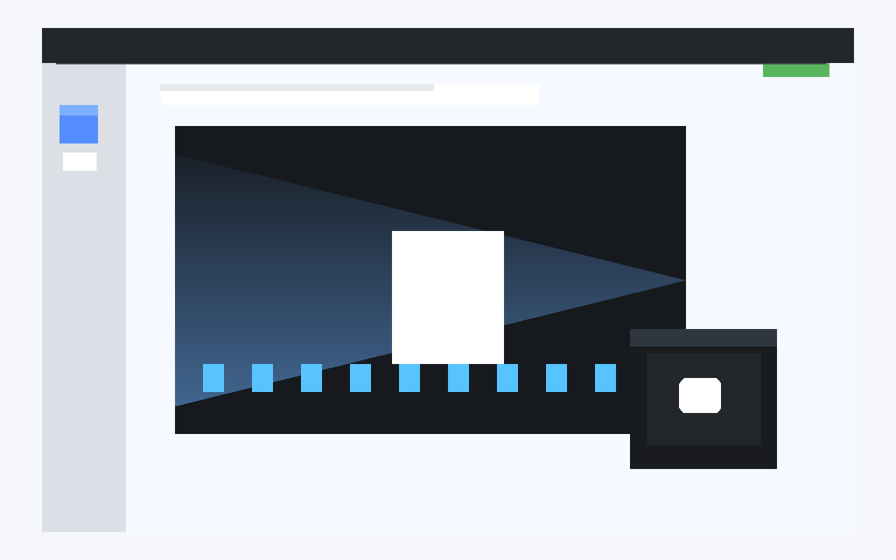

# PIP

Enable Picture-in-Picture for videos.

   

## Table of contents

- [Overview / Architecture](#overview--architecture)
- [Features](#features)
- [Screenshots](#screenshots)
- [Codebase Breakdown](#codebase-breakdown)
- [Permissions](#permissions)
- [Installation & Setup](#installation--setup)
- [Usage](#usage)
- [Contributing](#contributing)
- [Security](#security)
- [License](#license)

## Overview / Architecture

PIP is a lightweight browser extension designed to toggle Picture-in-Picture mode for HTML5 video elements directly from the browser toolbar. The project uses a Manifest V3 extension structure with a background service worker and a content script.

### Tech stack

- Browser extension: Manifest V3
- JavaScript
- Chrome/Edge extension APIs (`chrome.action`, `chrome.scripting`)
- HTML5 video API (`requestPictureInPicture`, `exitPictureInPicture`)

### How it works

- `background.js` listens for the toolbar click and injects the content script into the active tab.
- `content.js` finds the first available `<video>` element in the page.
- If the page is already in PiP, the script exits PiP; otherwise it requests PiP for the video.

## Features

- Toggle Picture-in-Picture mode from the extension icon
- Works with the first HTML5 video element available on the current page
- Uses the browser's native PiP functionality without additional UI
- Minimal permissions footprint for quick access and script execution

## Screenshots



The extension adds a lightweight toolbar action that toggles Picture-in-Picture mode for the first HTML5 video on the active page.

## Codebase Breakdown

```text
.
├── LICENSE
├── README.md
├── SECURITY.md
├── CONTRIBUTING.md
├── CODE_OF_CONDUCT.md
├── SUPPORT.md
├── CITATION.cff
├── CHANGELOG.md
├── .editorconfig
├── .gitattributes
├── .gitignore
├── .prettierrc
├── eslint.config.js
├── manifest.json
├── background.js
├── content.js
├── icons/
│   ├── icon16.png
│   └── icon128.png
├── .github/
│   ├── ISSUE_TEMPLATE/
│   │   ├── bug_report.md
│   │   └── feature_request.md
│   ├── PULL_REQUEST_TEMPLATE.md
│   └── workflows/
│       ├── ci.yml
│       └── release.yml
└── Prompt.txt
```

| File / directory | Purpose |
| --- | --- |
| `manifest.json` | Declares the extension metadata, permissions, toolbar button, and background service worker. |
| `background.js` | Responds to toolbar clicks and injects the content script into the active tab. |
| `content.js` | Finds a video element and enters or exits Picture-in-Picture mode. |
| `icons/` | Extension icon assets for the toolbar. |
| `.github/` | Issue templates, pull request template, and CI/release automation. |
| `LICENSE` | AGPL-3.0 license file retained from the repository. |
| `README.md` | Project overview, installation instructions, and usage guidance. |
| `SECURITY.md` | Security policy and reporting steps. |
| `CONTRIBUTING.md` | Contribution process and local setup notes. |

## Permissions

| Permission | Required by | Reason |
| --- | --- | --- |
| `activeTab` | `manifest.json` | Allows the extension to access the current tab only when the user clicks the toolbar icon. |
| `scripting` | `background.js` | Lets the extension inject the content script into the active page. |

## Installation & Setup

1. Clone the repository:
   ```bash
   git clone https://github.com/M003aad/PIP.git
   cd PIP
   ```
2. Open the project in your browser's extension management page.
3. Load the extension in developer mode:
   - Chrome: `chrome://extensions`
   - Edge: `edge://extensions`
   - Firefox: `about:addons` with a compatible MV3 build
4. Enable **Developer mode**.
5. Click **Load unpacked** and select the project directory.

There are no package dependencies or build steps in the current workspace, so the extension is ready to load directly as unpacked code.

## Usage

1. Open any page with an HTML5 video.
2. Click the PIP extension icon in the browser toolbar.
3. The extension injects a content script that toggles Picture-in-Picture mode for the first video on the page.
4. Click the toolbar icon again to exit PiP.

## Contributing

Contributions are welcome. Please read [CONTRIBUTING.md](./CONTRIBUTING.md) before opening an issue or submitting a pull request.

## Security

For security concerns, follow the process in [SECURITY.md](./SECURITY.md).

## License

This project is licensed under the GNU Affero General Public License v3.0. See [LICENSE](./LICENSE) for the full text.

Maintained by M003aad.
